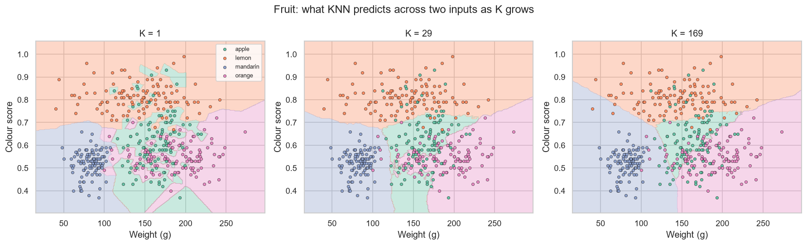

# KNN lab

K-Nearest Neighbours on Iris flowers and fruit: how the number of neighbours (K) and input scaling change the predictions, with an interactive demo.



## Results

Test set: 30% of each dataset, never used for tuning. K, vote weights and distance were tuned with 5-fold cross-validation on the training set.

| Dataset | Model | K | CV accuracy | Test accuracy | Macro F1 |
| --- | --- | --- | --- | --- | --- |
| Fruit (600) | KNN, scaled inputs | 29 | 0.862 | **0.861** | 0.862 |
| Fruit (600) | KNN, raw inputs | 3 | 0.705 | 0.694 | 0.695 |
| Iris (150) | KNN, scaled inputs | 7 | 0.971 | 0.933 | 0.933 |
| Iris (150) | KNN, raw inputs | 7 | 0.981 | **0.956** | 0.955 |

- **Scaling matters when units differ.** Fruit weight runs into the hundreds of grams and the colour score from 0 to 1. Without scaling, KNN ignores colour (permutation importance 0.003 against 0.218 scaled), and colour is what tells lemons apart.
- **It doesn't when units match.** Iris measurements are all centimetres on similar ranges; the gap between the two models is one test flower.
- **K trades noise for detail.** K = 1 follows every stray example; on fruit, accuracy climbs to K of about 25 to 41 and then falls as the smaller groups get outvoted. See `outputs/figures/*/k_sweep.png`.

Full tables: [docs/results.md](docs/results.md).

## Run it

Needs Python 3.14+ and [uv](https://docs.astral.sh/uv/).

```bash
uv sync
uv run python main.py
uv run streamlit run app.py
```

`main.py` writes figures and tables to `outputs/` and models to `models/` (both are committed, so the demo works without running it). Iris ships with scikit-learn; the fruit table is generated with a fixed seed, so nothing is downloaded.

## The demo

- **Overview**: what KNN is and what was found, for someone arriving from a link.
- **Classify**: start from a typical flower or fruit, change the measurements, and see the prediction, the class probabilities and the K neighbours that voted.
- **Effect of K**: drag K and watch test accuracy with scaled and raw inputs side by side.
- **Results**: model comparison, mistakes, permutation importance, K sweep and data checks.

## Layout

```
knn_lab/      spec.py (datasets and models), data.py, knn.py (decision maps, neighbours)
pxlab/        shared engine (vendored): data checks, pipelines, tuning, evaluation, app helpers
main.py       the full study
app.py        the Streamlit demo
docs/         methodology, results, deploy
```

## Data

- **Iris**: Fisher (1936) via scikit-learn's bundled copy of the [UCI Iris dataset](https://archive.ics.uci.edu/dataset/53/iris), CC BY 4.0.
- **Fruit**: generated in `knn_lab/data.py` from per-fruit averages and spreads. It is a teaching dataset, not real measurements.

## License

MIT
