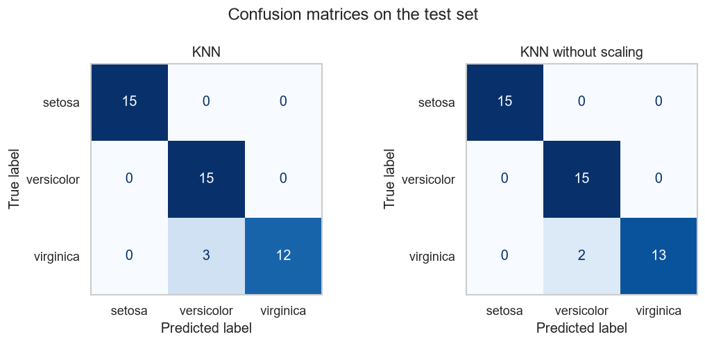
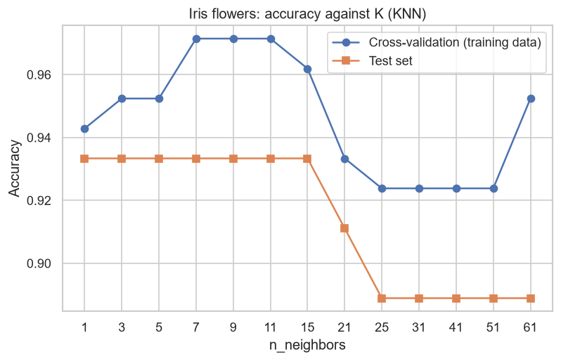
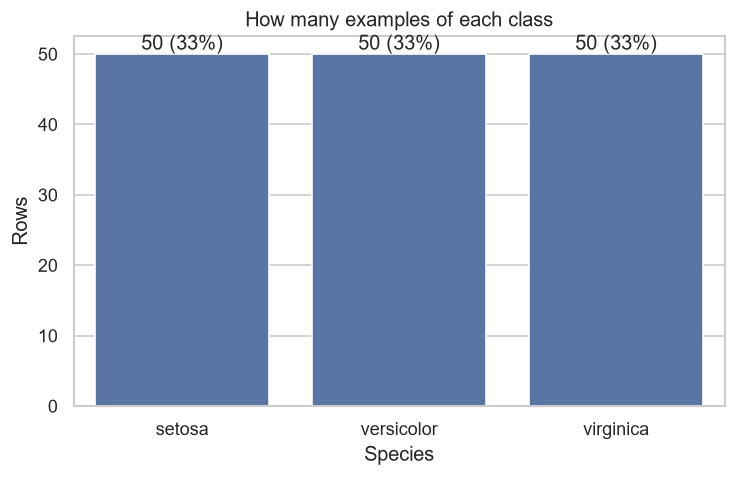
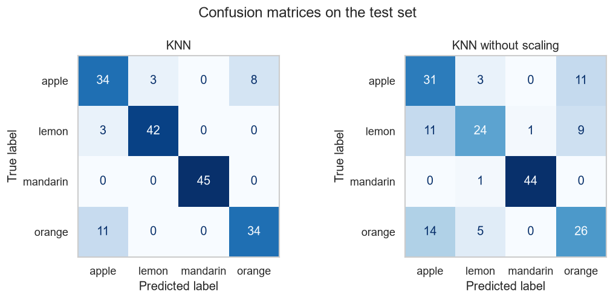
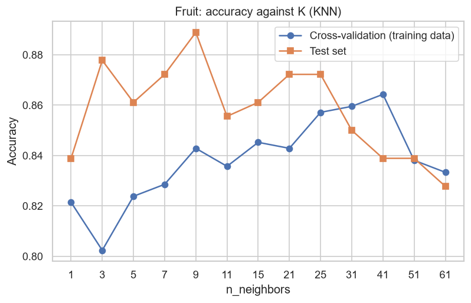
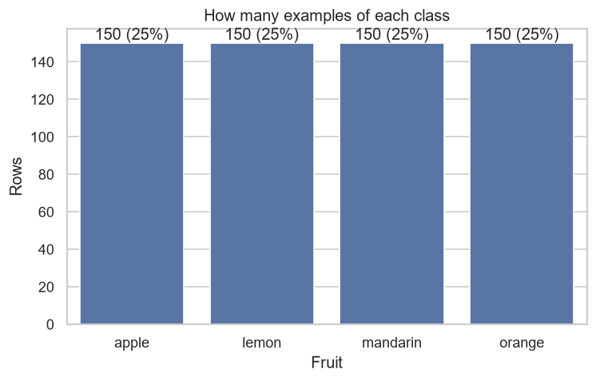
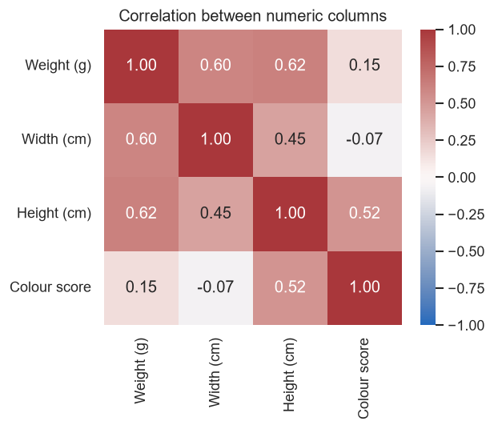

# Results

Produced by `python main.py`. Test sets are 30% of each dataset and were not used for tuning or model choice.

## Iris flowers: Models

### Scaled against raw inputs

| Model | Role | CV accuracy | Accuracy | Precision | Recall | F1 |
| --- | --- | --- | --- | --- | --- | --- |
| KNN | Main | 0.971 | 0.933 | 0.944 | 0.933 | 0.933 |
| KNN without scaling | Comparison | 0.981 | 0.956 | 0.961 | 0.956 | 0.955 |

## Iris flowers: Mistakes

### Test examples the best model got wrong

| sepal_length | sepal_width | petal_length | petal_width | Real | Predicted |
| --- | --- | --- | --- | --- | --- |
| 6.0 | 3.0 | 4.8 | 1.8 | virginica | versicolor |
| 4.9 | 2.5 | 4.5 | 1.7 | virginica | versicolor |

## Iris flowers: Which inputs matter

### Permutation importance

|  | KNN | KNN without scaling |
| --- | --- | --- |
| Petal width (cm) | 0.2489 | 0.1578 |
| Petal length (cm) | 0.2111 | 0.5489 |
| Sepal length (cm) | 0.0222 | 0.0022 |
| Sepal width (cm) | 0.02 | 0.0 |

## Iris flowers: K sweep

### Scaled inputs

| n_neighbors | CV score | Test score |
| --- | --- | --- |
| 1 | 0.9429 | 0.9333 |
| 3 | 0.9524 | 0.9333 |
| 5 | 0.9524 | 0.9333 |
| 7 | 0.9714 | 0.9333 |
| 9 | 0.9714 | 0.9333 |
| 11 | 0.9714 | 0.9333 |
| 15 | 0.9619 | 0.9333 |
| 21 | 0.9333 | 0.9111 |
| 25 | 0.9238 | 0.8889 |
| 31 | 0.9238 | 0.8889 |
| 41 | 0.9238 | 0.8889 |
| 51 | 0.9238 | 0.8889 |
| 61 | 0.9524 | 0.8889 |

### Raw inputs

| n_neighbors | CV score | Test score |
| --- | --- | --- |
| 1 | 0.9619 | 0.9333 |
| 3 | 0.9619 | 0.9556 |
| 5 | 0.9714 | 0.9778 |
| 7 | 0.981 | 0.9556 |
| 9 | 0.981 | 0.9556 |
| 11 | 0.981 | 0.9556 |
| 15 | 0.981 | 0.9778 |
| 21 | 0.9714 | 0.9556 |
| 25 | 0.9714 | 0.9556 |
| 31 | 0.9714 | 0.9333 |
| 41 | 0.9714 | 0.9111 |
| 51 | 0.9714 | 0.9111 |
| 61 | 0.9714 | 0.9111 |

## Iris flowers: Data

### Data quality

| Column | Type | Missing | Distinct values |
| --- | --- | --- | --- |
| sepal_length | numeric | 0 | 35 |
| sepal_width | numeric | 0 | 23 |
| petal_length | numeric | 0 | 43 |
| petal_width | numeric | 0 | 22 |
| species | target | 0 | 3 |

## Fruit: Models

### Scaled against raw inputs

| Model | Role | CV accuracy | Accuracy | Precision | Recall | F1 |
| --- | --- | --- | --- | --- | --- | --- |
| KNN | Main | 0.862 | 0.861 | 0.863 | 0.861 | 0.862 |
| KNN without scaling | Comparison | 0.705 | 0.694 | 0.706 | 0.694 | 0.695 |

## Fruit: Mistakes

### Test examples the best model got wrong

| mass_g | width_cm | height_cm | color_score | Real | Predicted |
| --- | --- | --- | --- | --- | --- |
| 176.0 | 7.6 | 5.4 | 0.62 | orange | apple |
| 184.0 | 6.7 | 8.1 | 0.85 | apple | lemon |
| 182.0 | 7.1 | 6.2 | 0.42 | apple | orange |
| 154.0 | 7.5 | 9.0 | 0.68 | lemon | apple |
| 168.0 | 8.6 | 9.1 | 0.7 | orange | apple |
| 172.0 | 7.4 | 8.5 | 0.63 | orange | apple |
| 162.0 | 7.4 | 6.8 | 0.74 | lemon | apple |
| 202.0 | 7.2 | 8.1 | 0.78 | apple | lemon |
| 171.0 | 7.6 | 8.3 | 0.6 | apple | orange |
| 163.0 | 7.8 | 8.2 | 0.59 | orange | apple |
| 133.0 | 7.4 | 7.8 | 0.62 | orange | apple |
| 177.0 | 7.0 | 7.8 | 0.33 | apple | orange |
| 137.0 | 7.6 | 8.4 | 0.51 | apple | orange |
| 175.0 | 7.4 | 7.5 | 0.47 | apple | orange |
| 145.0 | 6.7 | 8.8 | 0.55 | orange | apple |
| 173.0 | 7.2 | 8.4 | 0.63 | orange | apple |
| 177.0 | 7.9 | 8.1 | 0.49 | apple | orange |
| 133.0 | 6.3 | 8.6 | 0.59 | orange | apple |
| 187.0 | 7.8 | 7.2 | 0.4 | apple | orange |
| 183.0 | 7.1 | 7.4 | 0.86 | apple | lemon |

## Fruit: Which inputs matter

### Permutation importance

|  | KNN | KNN without scaling |
| --- | --- | --- |
| Colour score | 0.2178 | 0.0033 |
| Height (cm) | 0.1906 | 0.1622 |
| Weight (g) | 0.1322 | 0.3022 |
| Width (cm) | 0.1072 | 0.0617 |

## Fruit: K sweep

### Scaled inputs

| n_neighbors | CV score | Test score |
| --- | --- | --- |
| 1 | 0.8214 | 0.8389 |
| 3 | 0.8024 | 0.8778 |
| 5 | 0.8238 | 0.8611 |
| 7 | 0.8286 | 0.8722 |
| 9 | 0.8429 | 0.8889 |
| 11 | 0.8357 | 0.8556 |
| 15 | 0.8452 | 0.8611 |
| 21 | 0.8429 | 0.8722 |
| 25 | 0.8571 | 0.8722 |
| 31 | 0.8595 | 0.85 |
| 41 | 0.8643 | 0.8389 |
| 51 | 0.8381 | 0.8389 |
| 61 | 0.8333 | 0.8278 |

### Raw inputs

| n_neighbors | CV score | Test score |
| --- | --- | --- |
| 1 | 0.6667 | 0.7 |
| 3 | 0.7048 | 0.6944 |
| 5 | 0.6929 | 0.7056 |
| 7 | 0.6667 | 0.6889 |
| 9 | 0.6476 | 0.6944 |
| 11 | 0.6595 | 0.7056 |
| 15 | 0.6571 | 0.7056 |
| 21 | 0.6548 | 0.7056 |
| 25 | 0.6667 | 0.7167 |
| 31 | 0.6571 | 0.7056 |
| 41 | 0.6738 | 0.7056 |
| 51 | 0.6738 | 0.6889 |
| 61 | 0.6619 | 0.6833 |

## Fruit: Data

### Data quality

| Column | Type | Missing | Distinct values |
| --- | --- | --- | --- |
| mass_g | numeric | 0 | 180 |
| width_cm | numeric | 0 | 38 |
| height_cm | numeric | 0 | 61 |
| color_score | numeric | 0 | 61 |
| fruit | target | 0 | 4 |

