# Results

Produced by `python main.py`. Test sets are 30% of each dataset and were not used for tuning or model choice.

## Iris flowers: Models

### Scaled against raw inputs

| Model | Role | CV accuracy | Accuracy | Precision | Recall | F1 |
| --- | --- | --- | --- | --- | --- | --- |
| KNN | Main | 0.971 | 0.933 | 0.944 | 0.933 | 0.933 |
| KNN without scaling | Comparison | 0.981 | 0.956 | 0.961 | 0.956 | 0.955 |

## Iris flowers: Key findings

### What the in-depth analysis found

| Finding |
| --- |
| KNN without scaling scores Accuracy 0.956 on the test set (95% interval 0.889 to 1.000); the baseline that ignores the inputs scores 0.333. |
| KNN without scaling against KNN on right or wrong answers (McNemar): could be chance (p = 1.000). |
| KNN without scaling against Baseline (ignores the inputs) on right or wrong answers (McNemar): real difference (p = 0.000). |
| KNN generalises well: training and validation accuracy are close (+0.029); validation has levelled off, so more data alone would help little. |
| KNN without scaling generalises well: training and validation accuracy are close (+0.019); validation has levelled off, so more data alone would help little. |
| The most common mix-up: virginica predicted as versicolor (2 cases, 13% of virginica). |
| When KNN without scaling is at least 90% sure it is right 100% of the time (80% of test cases). |

## Iris flowers: Reliability

Bootstrap 95% intervals: how much each test score could move with a different test sample.

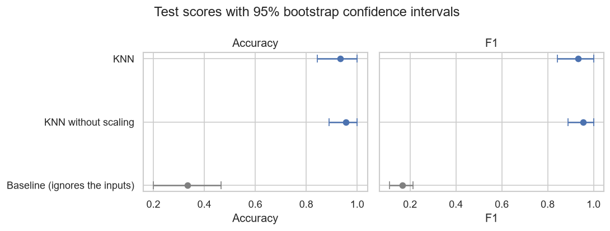

### Confidence intervals

| Model | Score | Test value | Low | High |
| --- | --- | --- | --- | --- |
| KNN | Accuracy | 0.9333 | 0.8444 | 1.0 |
| KNN | F1 | 0.9327 | 0.8412 | 1.0 |
| KNN without scaling | Accuracy | 0.9556 | 0.8889 | 1.0 |
| KNN without scaling | F1 | 0.9554 | 0.8885 | 1.0 |
| Baseline (ignores the inputs) | Accuracy | 0.3333 | 0.2 | 0.4667 |
| Baseline (ignores the inputs) | F1 | 0.1667 | 0.1111 | 0.2121 |

### Is the best model really better? (paired tests)

| Best model | Compared with | Best is better on | Other is better on | Test | p-value | Verdict |
| --- | --- | --- | --- | --- | --- | --- |
| KNN without scaling | KNN | 2 | 1 | McNemar | 1.0 | Could be chance |
| KNN without scaling | Baseline (ignores the inputs) | 28 | 0 | McNemar | 0.0 | Real difference |

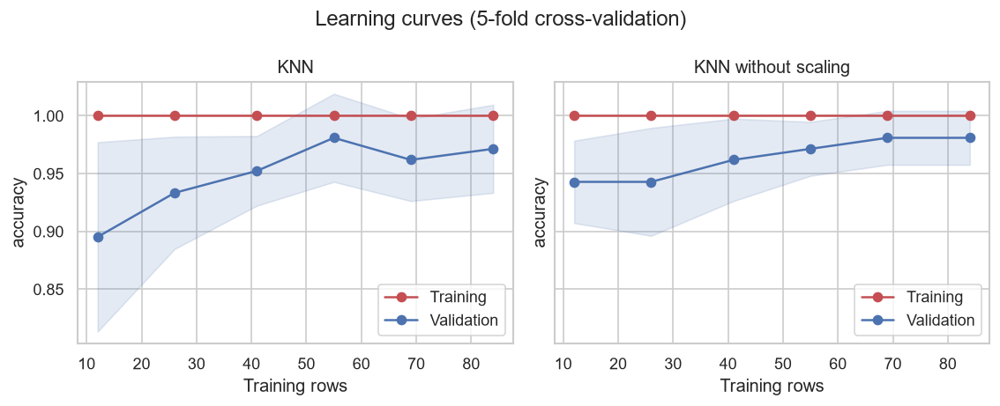

### Learning curves

| Model | Training rows | Training score | Validation score |
| --- | --- | --- | --- |
| KNN | 12 | 1.0 | 0.8952 |
| KNN | 26 | 1.0 | 0.9333 |
| KNN | 41 | 1.0 | 0.9524 |
| KNN | 55 | 1.0 | 0.981 |
| KNN | 69 | 1.0 | 0.9619 |
| KNN | 84 | 1.0 | 0.9714 |
| KNN without scaling | 12 | 1.0 | 0.9429 |
| KNN without scaling | 26 | 1.0 | 0.9429 |
| KNN without scaling | 41 | 1.0 | 0.9619 |
| KNN without scaling | 55 | 1.0 | 0.9714 |
| KNN without scaling | 69 | 1.0 | 0.981 |
| KNN without scaling | 84 | 1.0 | 0.981 |

## Iris flowers: Error analysis

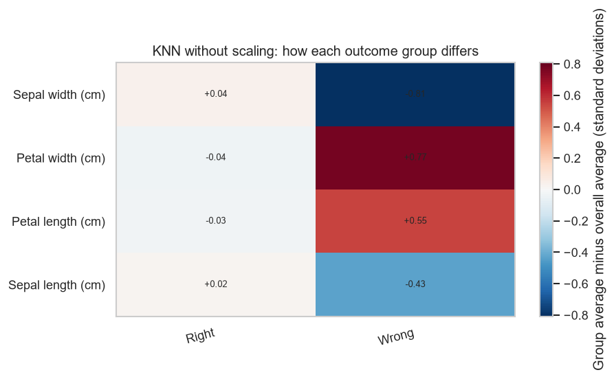

### Average inputs per outcome group

| Input | Right | Wrong |
| --- | --- | --- |
| Cases | 43.0 | 2.0 |
| Sepal width (cm) | 3.077 | 2.75 |
| Petal width (cm) | 1.158 | 1.75 |
| Petal length (cm) | 3.651 | 4.65 |
| Sepal length (cm) | 5.788 | 5.45 |

### Classes the model mixes up

| Real class | Predicted as | Cases | Share of the real class |
| --- | --- | --- | --- |
| virginica | versicolor | 2 | 0.133 |

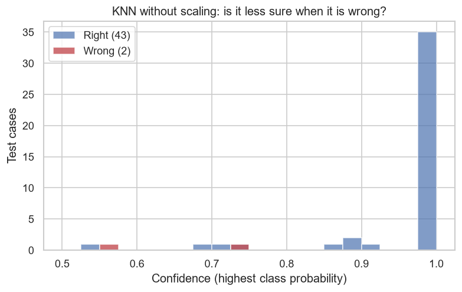

### Accuracy by confidence

| Confidence | Cases | Share of the test set | Accuracy |
| --- | --- | --- | --- |
| 0% to 60% | 2 | 0.044 | 0.5 |
| 60% to 70% | 1 | 0.022 | 1.0 |
| 70% to 80% | 3 | 0.067 | 0.667 |
| 80% to 90% | 3 | 0.067 | 1.0 |
| 90% to 100% | 36 | 0.8 | 1.0 |

## Iris flowers: Mistakes

### Test examples the best model got wrong

| sepal_length | sepal_width | petal_length | petal_width | Real | Predicted |
| --- | --- | --- | --- | --- | --- |
| 6.0 | 3.0 | 4.8 | 1.8 | virginica | versicolor |
| 4.9 | 2.5 | 4.5 | 1.7 | virginica | versicolor |

## Iris flowers: Which inputs matter

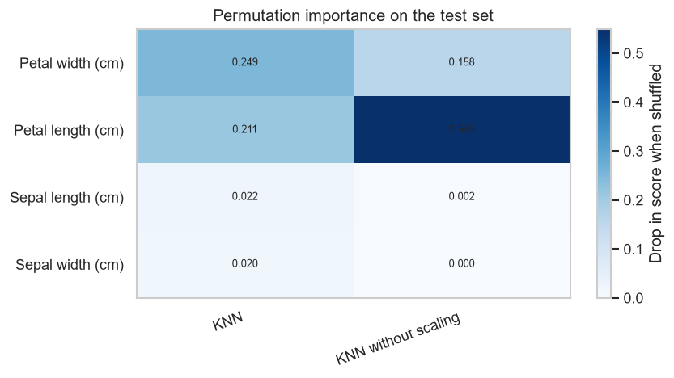

### Permutation importance

|  | KNN | KNN without scaling |
| --- | --- | --- |
| Petal width (cm) | 0.2489 | 0.1578 |
| Petal length (cm) | 0.2111 | 0.5489 |
| Sepal length (cm) | 0.0222 | 0.0022 |
| Sepal width (cm) | 0.02 | 0.0 |

## Iris flowers: K sweep

### Scaled inputs

| n_neighbors | CV score | Test score |
| --- | --- | --- |
| 1 | 0.9429 | 0.9333 |
| 3 | 0.9524 | 0.9333 |
| 5 | 0.9524 | 0.9333 |
| 7 | 0.9714 | 0.9333 |
| 9 | 0.9714 | 0.9333 |
| 11 | 0.9714 | 0.9333 |
| 15 | 0.9619 | 0.9333 |
| 21 | 0.9333 | 0.9111 |
| 25 | 0.9238 | 0.8889 |
| 31 | 0.9238 | 0.8889 |
| 41 | 0.9238 | 0.8889 |
| 51 | 0.9238 | 0.8889 |
| 61 | 0.9524 | 0.8889 |

### Raw inputs

| n_neighbors | CV score | Test score |
| --- | --- | --- |
| 1 | 0.9619 | 0.9333 |
| 3 | 0.9619 | 0.9556 |
| 5 | 0.9714 | 0.9778 |
| 7 | 0.981 | 0.9556 |
| 9 | 0.981 | 0.9556 |
| 11 | 0.981 | 0.9556 |
| 15 | 0.981 | 0.9778 |
| 21 | 0.9714 | 0.9556 |
| 25 | 0.9714 | 0.9556 |
| 31 | 0.9714 | 0.9333 |
| 41 | 0.9714 | 0.9111 |
| 51 | 0.9714 | 0.9111 |
| 61 | 0.9714 | 0.9111 |

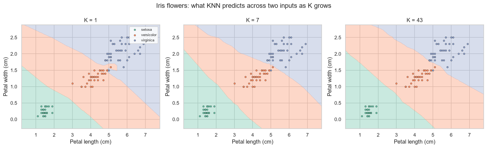

## Iris flowers: Data

### Data quality

| Column | Type | Missing | Distinct values |
| --- | --- | --- | --- |
| sepal_length | numeric | 0 | 35 |
| sepal_width | numeric | 0 | 23 |
| petal_length | numeric | 0 | 43 |
| petal_width | numeric | 0 | 22 |
| species | target | 0 | 3 |

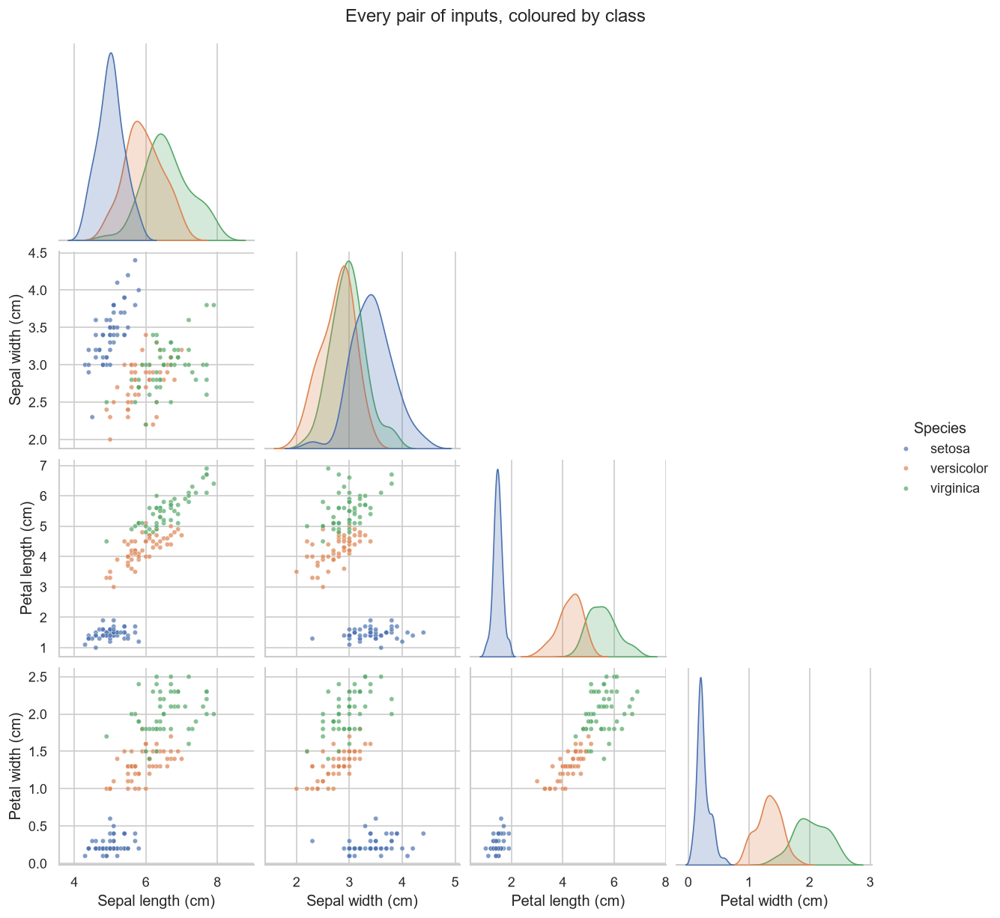

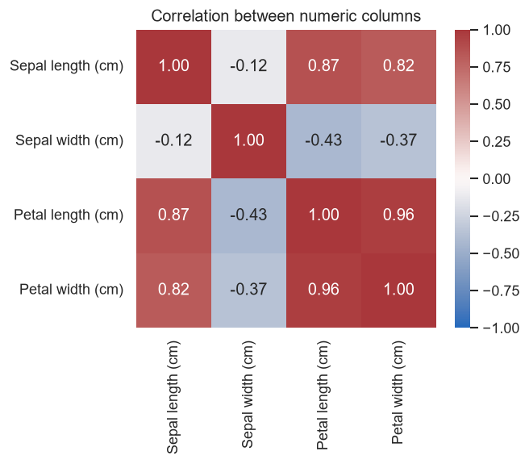

## Fruit: Models

### Scaled against raw inputs

| Model | Role | CV accuracy | Accuracy | Precision | Recall | F1 |
| --- | --- | --- | --- | --- | --- | --- |
| KNN | Main | 0.862 | 0.861 | 0.863 | 0.861 | 0.862 |
| KNN without scaling | Comparison | 0.705 | 0.694 | 0.706 | 0.694 | 0.695 |

## Fruit: Key findings

### What the in-depth analysis found

| Finding |
| --- |
| KNN scores Accuracy 0.861 on the test set (95% interval 0.806 to 0.911); the baseline that ignores the inputs scores 0.250. |
| KNN against KNN without scaling on right or wrong answers (McNemar): real difference (p = 0.000). |
| KNN against Baseline (ignores the inputs) on right or wrong answers (McNemar): real difference (p = 0.000). |
| KNN generalises well: training and validation accuracy are close (-0.001); validation has levelled off, so more data alone would help little. |
| KNN without scaling overfits: training accuracy 1.000 against validation 0.705; validation is still rising, so more data would likely help. |
| The most common mix-up: orange predicted as apple (11 cases, 24% of orange). |
| When KNN is at least 90% sure it is right 100% of the time (44% of test cases). |

## Fruit: Reliability

Bootstrap 95% intervals: how much each test score could move with a different test sample.

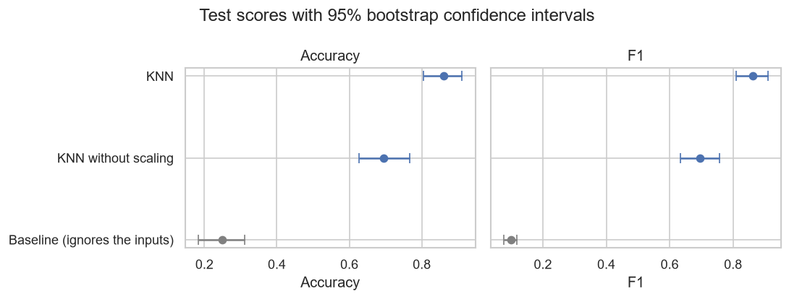

### Confidence intervals

| Model | Score | Test value | Low | High |
| --- | --- | --- | --- | --- |
| KNN | Accuracy | 0.8611 | 0.8056 | 0.9111 |
| KNN | F1 | 0.8615 | 0.8092 | 0.9093 |
| KNN without scaling | Accuracy | 0.6944 | 0.6278 | 0.7667 |
| KNN without scaling | F1 | 0.6946 | 0.634 | 0.7575 |
| Baseline (ignores the inputs) | Accuracy | 0.25 | 0.1833 | 0.3111 |
| Baseline (ignores the inputs) | F1 | 0.1 | 0.0775 | 0.1186 |

### Is the best model really better? (paired tests)

| Best model | Compared with | Best is better on | Other is better on | Test | p-value | Verdict |
| --- | --- | --- | --- | --- | --- | --- |
| KNN | KNN without scaling | 35 | 5 | McNemar | 0.0 | Real difference |
| KNN | Baseline (ignores the inputs) | 121 | 11 | McNemar | 0.0 | Real difference |

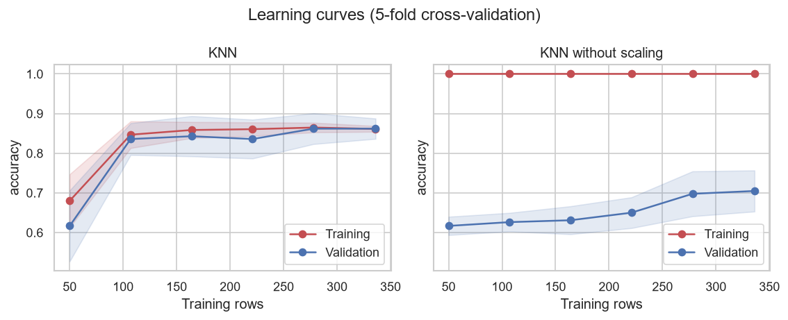

### Learning curves

| Model | Training rows | Training score | Validation score |
| --- | --- | --- | --- |
| KNN | 50 | 0.68 | 0.6167 |
| KNN | 107 | 0.8467 | 0.8357 |
| KNN | 164 | 0.8585 | 0.8429 |
| KNN | 221 | 0.8606 | 0.8357 |
| KNN | 278 | 0.8647 | 0.8619 |
| KNN | 336 | 0.8613 | 0.8619 |
| KNN without scaling | 50 | 1.0 | 0.6167 |
| KNN without scaling | 107 | 1.0 | 0.6262 |
| KNN without scaling | 164 | 1.0 | 0.631 |
| KNN without scaling | 221 | 1.0 | 0.65 |
| KNN without scaling | 278 | 1.0 | 0.6976 |
| KNN without scaling | 336 | 1.0 | 0.7048 |

## Fruit: Error analysis

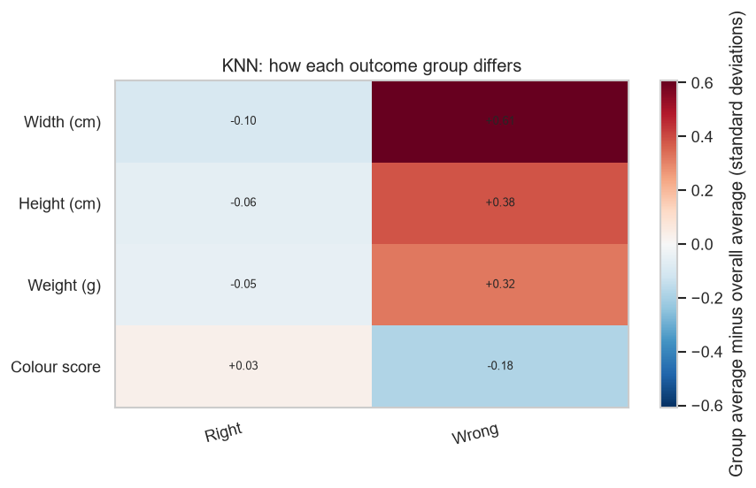

### Average inputs per outcome group

| Input | Right | Wrong |
| --- | --- | --- |
| Cases | 155.0 | 25.0 |
| Width (cm) | 6.784 | 7.32 |
| Height (cm) | 7.167 | 7.944 |
| Weight (g) | 145.045 | 163.4 |
| Colour score | 0.631 | 0.6 |

### Classes the model mixes up

| Real class | Predicted as | Cases | Share of the real class |
| --- | --- | --- | --- |
| orange | apple | 11 | 0.244 |
| apple | orange | 8 | 0.178 |
| apple | lemon | 3 | 0.067 |
| lemon | apple | 3 | 0.067 |

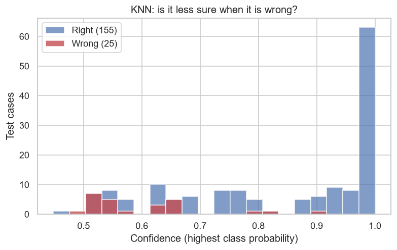

### Accuracy by confidence

| Confidence | Cases | Share of the test set | Accuracy |
| --- | --- | --- | --- |
| 0% to 60% | 35 | 0.194 | 0.6 |
| 60% to 70% | 29 | 0.161 | 0.724 |
| 70% to 80% | 22 | 0.122 | 0.955 |
| 80% to 90% | 14 | 0.078 | 0.857 |
| 90% to 100% | 80 | 0.444 | 1.0 |

## Fruit: Mistakes

### Test examples the best model got wrong

| mass_g | width_cm | height_cm | color_score | Real | Predicted |
| --- | --- | --- | --- | --- | --- |
| 176.0 | 7.6 | 5.4 | 0.62 | orange | apple |
| 184.0 | 6.7 | 8.1 | 0.85 | apple | lemon |
| 182.0 | 7.1 | 6.2 | 0.42 | apple | orange |
| 154.0 | 7.5 | 9.0 | 0.68 | lemon | apple |
| 168.0 | 8.6 | 9.1 | 0.7 | orange | apple |
| 172.0 | 7.4 | 8.5 | 0.63 | orange | apple |
| 162.0 | 7.4 | 6.8 | 0.74 | lemon | apple |
| 202.0 | 7.2 | 8.1 | 0.78 | apple | lemon |
| 171.0 | 7.6 | 8.3 | 0.6 | apple | orange |
| 163.0 | 7.8 | 8.2 | 0.59 | orange | apple |
| 133.0 | 7.4 | 7.8 | 0.62 | orange | apple |
| 177.0 | 7.0 | 7.8 | 0.33 | apple | orange |
| 137.0 | 7.6 | 8.4 | 0.51 | apple | orange |
| 175.0 | 7.4 | 7.5 | 0.47 | apple | orange |
| 145.0 | 6.7 | 8.8 | 0.55 | orange | apple |
| 173.0 | 7.2 | 8.4 | 0.63 | orange | apple |
| 177.0 | 7.9 | 8.1 | 0.49 | apple | orange |
| 133.0 | 6.3 | 8.6 | 0.59 | orange | apple |
| 187.0 | 7.8 | 7.2 | 0.4 | apple | orange |
| 183.0 | 7.1 | 7.4 | 0.86 | apple | lemon |

## Fruit: Which inputs matter

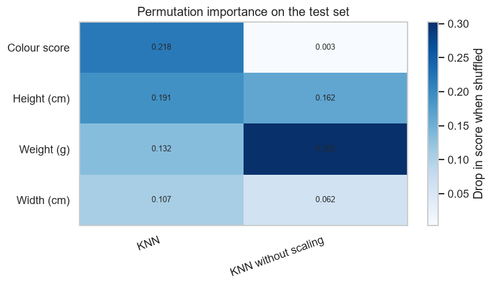

### Permutation importance

|  | KNN | KNN without scaling |
| --- | --- | --- |
| Colour score | 0.2178 | 0.0033 |
| Height (cm) | 0.1906 | 0.1622 |
| Weight (g) | 0.1322 | 0.3022 |
| Width (cm) | 0.1072 | 0.0617 |

## Fruit: K sweep

### Scaled inputs

| n_neighbors | CV score | Test score |
| --- | --- | --- |
| 1 | 0.8214 | 0.8389 |
| 3 | 0.8024 | 0.8778 |
| 5 | 0.8238 | 0.8611 |
| 7 | 0.8286 | 0.8722 |
| 9 | 0.8429 | 0.8889 |
| 11 | 0.8357 | 0.8556 |
| 15 | 0.8452 | 0.8611 |
| 21 | 0.8429 | 0.8722 |
| 25 | 0.8571 | 0.8722 |
| 31 | 0.8595 | 0.85 |
| 41 | 0.8643 | 0.8389 |
| 51 | 0.8381 | 0.8389 |
| 61 | 0.8333 | 0.8278 |

### Raw inputs

| n_neighbors | CV score | Test score |
| --- | --- | --- |
| 1 | 0.6667 | 0.7 |
| 3 | 0.7048 | 0.6944 |
| 5 | 0.6929 | 0.7056 |
| 7 | 0.6667 | 0.6889 |
| 9 | 0.6476 | 0.6944 |
| 11 | 0.6595 | 0.7056 |
| 15 | 0.6571 | 0.7056 |
| 21 | 0.6548 | 0.7056 |
| 25 | 0.6667 | 0.7167 |
| 31 | 0.6571 | 0.7056 |
| 41 | 0.6738 | 0.7056 |
| 51 | 0.6738 | 0.6889 |
| 61 | 0.6619 | 0.6833 |

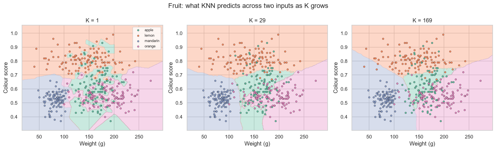

## Fruit: Data

### Data quality

| Column | Type | Missing | Distinct values |
| --- | --- | --- | --- |
| mass_g | numeric | 0 | 180 |
| width_cm | numeric | 0 | 38 |
| height_cm | numeric | 0 | 61 |
| color_score | numeric | 0 | 61 |
| fruit | target | 0 | 4 |

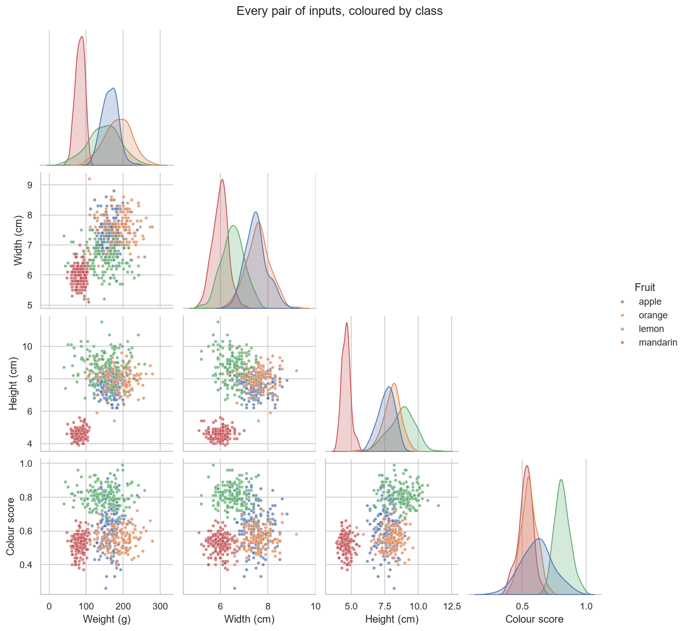

